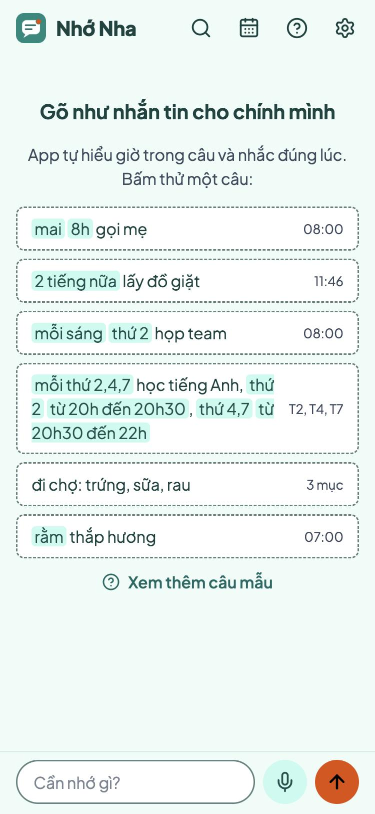
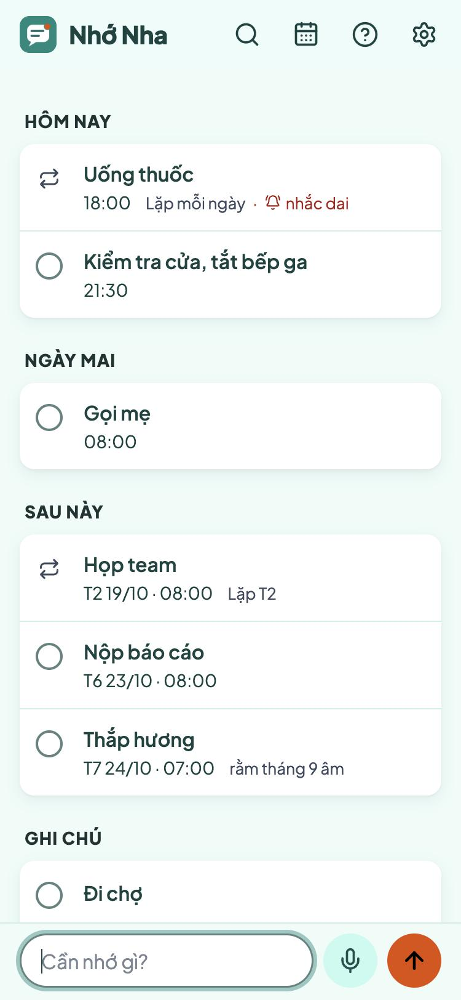
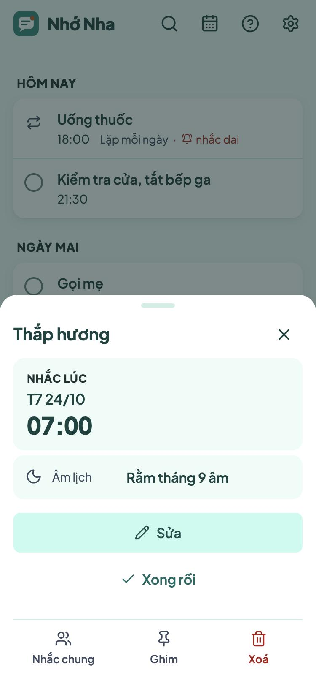

# Nhớ Nha

Ghi chú nhắc giờ cho người Việt. Gõ như nhắn tin cho chính mình: "mai 8h gọi mẹ", "rằm thắp hương", "9h, 18h hằng ngày uống thuốc". App tự hiểu giờ, cả ngày âm lịch, và nhắc đúng lúc bằng thông báo, kể cả khi đã đóng app.

**Dùng thử:** https://nho-nha.pages.dev. Miễn phí, không quảng cáo, mã nguồn mở ([MIT](LICENSE)).

<p>
  
  
  
</p>

## Làm được gì

- **Hiểu câu như người nói.** "thứ 6 tuần sau nộp báo cáo", "2 tiếng nữa lấy đồ giặt", "mỗi sáng thứ 2 họp team", "mai 9h và 15h họp" (thành 2 lời nhắc), "mỗi thứ 2,4,7 học tiếng Anh, thứ 2 từ 20h đến 20h30, thứ 4,7 từ 20h30 đến 22h". Lịch âm: "rằm thắp hương", "mùng 1 hằng tháng đi chùa", "10/3 âm sinh nhật bà". Thêm "!" ở cuối là nhắc dai: nhắc lại 10 phút một lần trong một giờ, tới khi bấm Xong. "đi chợ: trứng, sữa, rau" thành danh sách để đánh dấu.
- **Nhắc đúng giờ, cả khi đóng app.** Bấm vào thông báo để Xong, hoặc nhắc lại sau 10 phút, 1 giờ, tối nay, sáng mai. Mỗi sáng một bản tin những việc trong ngày.
- **Dùng ngay** không cần đăng nhập, hoặc **đăng nhập Google** để dùng chung trên nhiều máy. Ghi được cả khi mất mạng.
- **Nhắc chung** cho gia đình, lớp học, nhóm bạn: mời bằng link qua Zalo hay Messenger, cả nhóm cùng thấy và cùng được nhắc. Mỗi người tự bấm Xong ("7h đi nhậu"), chỉ nhắc một người ("21h bố uống thuốc"), báo cho mình nếu người kia chưa bấm Xong, giờ ngủ, chống spam (mỗi nhóm kêu tối đa 20 lần một giờ). Mỗi nhóm tối đa 20 người, mỗi người tối đa 10 nhóm.
- **Phím tắt iPhone:** Siri, gõ hai lần vào lưng máy, hay nút Chia sẻ gửi câu vào app.
- **Giao diện:** 11 màu sẵn hoặc màu tự chọn, nhiều kiểu nền, sáng hoặc tối.

## Cài lên điện thoại

- **iPhone (iOS 16.4 trở lên):** mở link bằng Safari → Chia sẻ → Thêm vào MH chính. Mở Nhớ Nha từ màn hình chính rồi bấm "Bật thông báo". iPhone chỉ gửi thông báo cho app đã cài ở màn hình chính. Đăng nhập Google trong Safari trước thì app cài vào tự đăng nhập theo.
- **Android, máy tính:** Chrome hay Edge thì bấm nút **Cài app** trong app. Safari trên Mac: Tệp → Thêm vào Dock. Firefox không cài được app web.

Thử ngay: Cài đặt → "Thử: nhắc sau 1 phút", khoá máy, đợi.

## Cần biết

- **Thông báo cần mạng.** Đến giờ, máy chủ gửi thông báo qua Apple hay Google; điện thoại mất mạng đúng lúc đó thì có mạng lại mới hiện.
- **Dùng ngay gắn với một máy.** Đổi máy hay xoá dữ liệu trình duyệt là mất ghi chú. Đăng nhập Google sau đó thì mọi ghi chú gộp vào tài khoản. Tài khoản "dùng ngay" không còn máy nào mở được (sau 400 ngày) thì tự bị xoá.
- **Riêng tư.** Ghi chú chỉ dùng để đồng bộ và nhắc giờ: không bán, không quảng cáo. Nội dung thông báo được mã hoá riêng cho từng máy. Xoá tài khoản trong Cài đặt là xoá hết ngay. Để đếm số máy đã cài, mỗi máy báo mỗi ngày một lần một mã ngẫu nhiên và loại máy, không gắn với tài khoản nào. Chi tiết ở [trang quyền riêng tư](https://nho-nha.pages.dev/rieng-tu).

## Tự chạy bản của riêng bạn

App chạy trọn trên gói miễn phí của Cloudflare: một Worker làm máy chủ (`worker/`), cơ sở dữ liệu D1, và một Durable Object làm đồng hồ nhắc giờ. Cần Node 22.13 trở lên (nên dùng 24, như trong `.nvmrc`), [pnpm](https://pnpm.io), bash (macOS, Linux, hoặc WSL trên Windows) và một tài khoản Cloudflare.

1. Lấy code:

   ```bash
   git clone https://github.com/TrungHai0230396/nho-nha.git
   cd nho-nha
   pnpm install
   ```

2. Sửa phần `vars` trong `wrangler.jsonc` cho bản của bạn:

   | Biến | Đặt thành |
   |---|---|
   | `CONTACT_EMAIL` | Email của bạn, hiện ở trang /rieng-tu. Khi `PUBLIC_ORIGIN` để trống, đây cũng là địa chỉ liên hệ gửi kèm cho dịch vụ thông báo (có `PUBLIC_ORIGIN` thì gửi địa chỉ đó). |
   | `PUBLIC_ORIGIN` | `""` để dùng địa chỉ `*.workers.dev` của bạn, hoặc tên miền riêng, ví dụ `"https://nhacviec.example.com"`. |
   | `GOOGLE_CLIENT_ID` | `""` cho tới khi có client của riêng bạn (xem [Đăng nhập Google](#đăng-nhập-google)). |

   `database_id` để nguyên: lần chạy đầu, script tự tạo database trong tài khoản của bạn và ghi id mới vào.

   Để `PUBLIC_ORIGIN` trống thì đổi luôn `"workers_dev": false` ở đầu file thành `true`. Bản gốc tắt địa chỉ `*.workers.dev`, vì chỉ dùng địa chỉ Pages.

3. Đưa lên mạng, lần đầu và mỗi lần cập nhật:

   ```bash
   scripts/deploy.sh
   ```

   Script mở trình duyệt để đăng nhập Cloudflare, tạo database, chạy test, đưa app lên, tạo khoá gửi thông báo `VAPID_KEY` (cất thẳng vào Cloudflare, không in ra), rồi in địa chỉ app.

**Không bao giờ đổi `VAPID_KEY`.** Đổi là mọi máy đã bật thông báo đều thôi nhận.

### Đăng nhập Google

Tuỳ chọn: không có thì app vẫn chạy với "Dùng ngay". Muốn bật, vào [Google Cloud Console](https://console.cloud.google.com/):

1. Tạo một project mới cho app.
2. Google Auth Platform → Branding: tên app, email hỗ trợ, trang chủ là địa chỉ app, chính sách quyền riêng tư là `<địa chỉ app>/rieng-tu`, tên miền được phép. Để trống logo: có logo thì Google đòi xác minh thêm.
3. Audience: chọn External, rồi Publish app. App chỉ xin tên, email, ảnh hồ sơ (`openid email profile`), nên không phải chờ Google duyệt.
4. Clients → Create client → Web application. Ở Authorized redirect URIs, điền `<địa chỉ app>/auth/google`. Bấm Download JSON ngay: Google chỉ cho xem client secret lúc vừa tạo.
5. Chép Client ID vào `GOOGLE_CLIENT_ID` trong `wrangler.jsonc`, đặt `PUBLIC_ORIGIN` đúng địa chỉ app, rồi chạy lại `scripts/deploy.sh`.
6. Chạy lệnh dưới, rồi dán client secret vào ô wrangler hỏi (chỉ thấy dấu `*`). Đừng dán khoá lên dòng lệnh: nó nằm lại trong lịch sử Terminal.

```bash
scripts/google-secret.sh
```

### Gói miễn phí

Đồng hồ nhắc giờ gửi tối đa 40 thông báo mỗi lượt (gói miễn phí cho mỗi lượt chạy 50 yêu cầu ra ngoài); phần còn lại sang lượt kế tiếp. Đông người dùng thì nâng lên Workers Paid (5 USD/tháng), rồi đặt biến `PUSH_CAP` lớn hơn trong `wrangler.jsonc`.

### Địa chỉ và tên riêng

Địa chỉ `*.workers.dev` mang tên tài khoản Cloudflare của bạn. Muốn khác thì gắn tên miền riêng vào Worker, hoặc dựng một project Cloudflare Pages chỉ chuyển tiếp vào Worker như thư mục `pages/` (đổi `name` trong `pages/wrangler.jsonc`, vì `nho-nha.pages.dev` đã có chủ, rồi chạy `scripts/pages.sh`). Nhớ đặt `PUBLIC_ORIGIN` là địa chỉ mới.

Mở bản của bạn cho người ngoài dùng thì đặt tên và icon khác (xem [Giấy phép](#giấy-phép)). Chữ "Nhớ Nha" nằm ở:

- `index.html`: thẻ `title` và `apple-mobile-web-app-title`
- `worker/app.ts`: manifest và trang quyền riêng tư
- `worker/cron.ts`: tên mặc định của thông báo
- `src/ui/Welcome.tsx`, `src/ui/Main.tsx`, `src/sw.js`

Icon vẽ lại bằng `python3 scripts/make-icons.py`. Đổi `name` trong `wrangler.jsonc` là đổi luôn địa chỉ `*.workers.dev`; có dùng `pages/` thì đổi cả `service` trong `pages/wrangler.jsonc` cho khớp.

## Chạy thử trên máy

```bash
pnpm install
cp .dev.vars.example .dev.vars
```

Tạo khoá gửi thông báo cho máy này, rồi dán kết quả vào sau `VAPID_KEY=` trong `.dev.vars` (để trống thì "Dùng ngay" báo lỗi):

```bash
bash -c '. scripts/chung.sh && new_vapid_key'
```

Rồi:

```bash
pnpm db:local
```

```bash
pnpm dev
```

Mở http://127.0.0.1:8787, bấm Đăng nhập. Bản chạy trên máy dùng "Google giả": chọn một người thử, không cần tài khoản thật.

```bash
pnpm test
```

```bash
pnpm typecheck
```

## English

Nhớ Nha is a reminder app for Vietnamese speakers. You type a line the way you would text yourself ("mai 8h gọi mẹ": call mom tomorrow at 8; "rằm thắp hương": burn incense on the full-moon day) and it reads the time, lunar calendar dates included, then reminds you on time with Web Push, even when the app is closed. It has a guest mode and Google sign-in, offline-first sync across devices, shared reminders for families and groups, and iPhone Shortcuts. The live app at https://nho-nha.pages.dev is free. The interface and the parser are Vietnamese only.

It runs entirely on Cloudflare's free plan: a Worker (TypeScript, `worker/`), D1 (SQLite), a Durable Object as the reminder clock, and a React PWA (`src/`). To run your own copy, set `CONTACT_EMAIL`, `PUBLIC_ORIGIN` and `GOOGLE_CLIENT_ID` in `wrangler.jsonc` (with `PUBLIC_ORIGIN` left empty, also `"workers_dev": true`), then run `scripts/deploy.sh`: it creates the D1 database, runs the tests, deploys, and stores a VAPID key as a Worker secret (never rotate it). Google sign-in is optional: create a Web OAuth client with the redirect URI `<your origin>/auth/google`, then run `scripts/google-secret.sh`.

## Giấy phép

Code theo giấy phép [MIT](LICENSE): ai cũng được dùng, sửa, phát hành lại, kể cả để kiếm tiền, miễn giữ lại thông báo bản quyền.

Tên "Nhớ Nha" và icon của app (`public/icons/`, `public/favicon.svg`) không nằm trong giấy phép MIT. Tự chạy cho mình, gia đình hay nhóm của mình thì cứ giữ nguyên; mở cho người ngoài dùng thì xin đặt tên và icon khác, để không ai nhầm với app gốc.

Phông Plus Jakarta Sans là của tác giả phông, theo giấy phép SIL Open Font License 1.1 (`public/fonts/OFL.txt`). Giấy phép của các thư viện đi kèm app (React, lucide-react) nằm trong `licenses.txt` của bản build, tức `/licenses.txt` trên app.

The code is MIT-licensed. The name "Nhớ Nha" and the app icon are not covered by the license: keep them for a copy you run for yourself, your family or your group, but give a copy you open to others its own name and icon.
